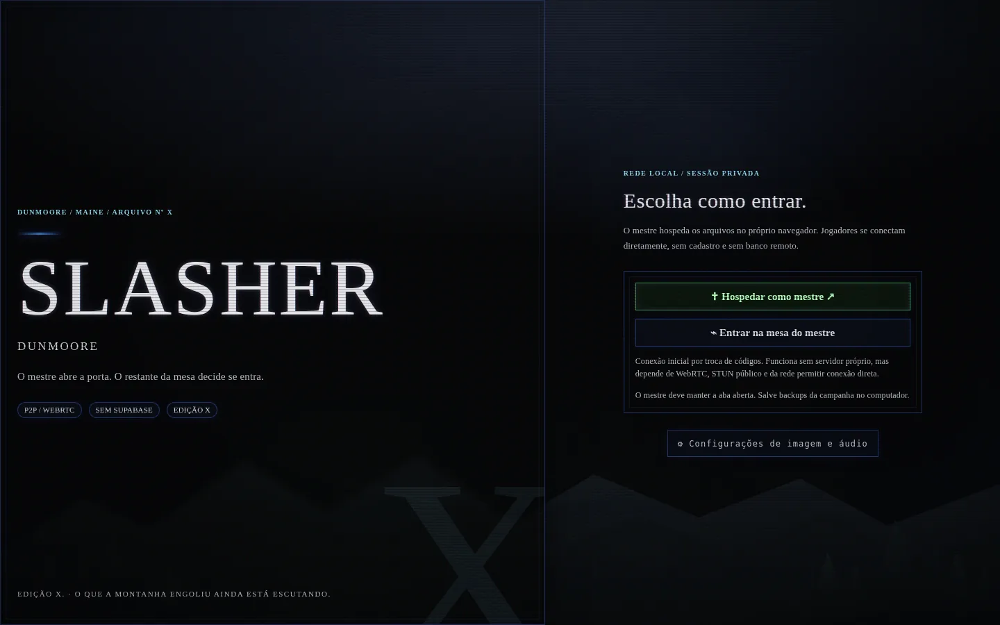
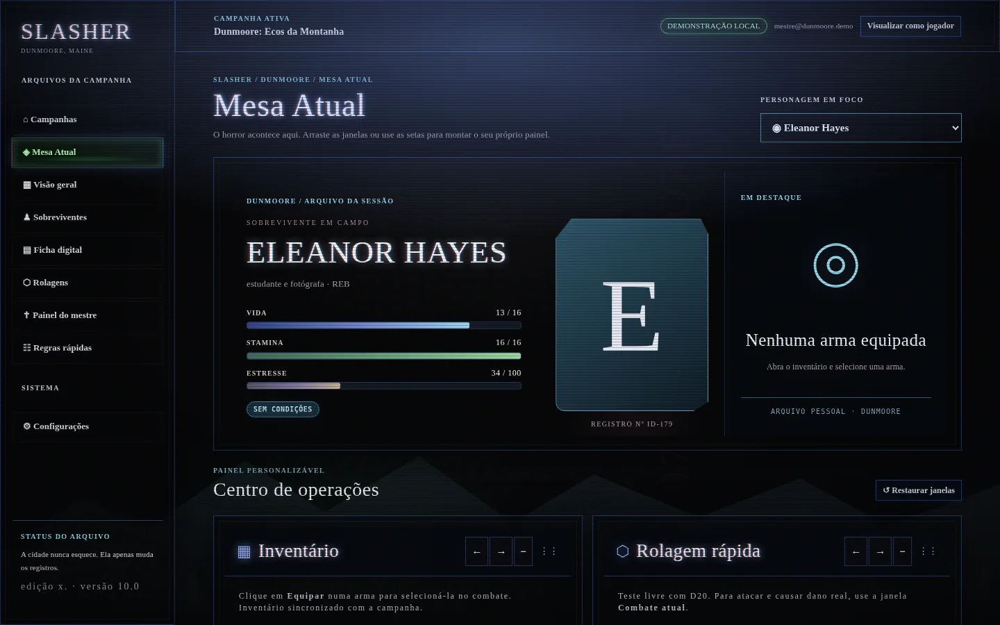
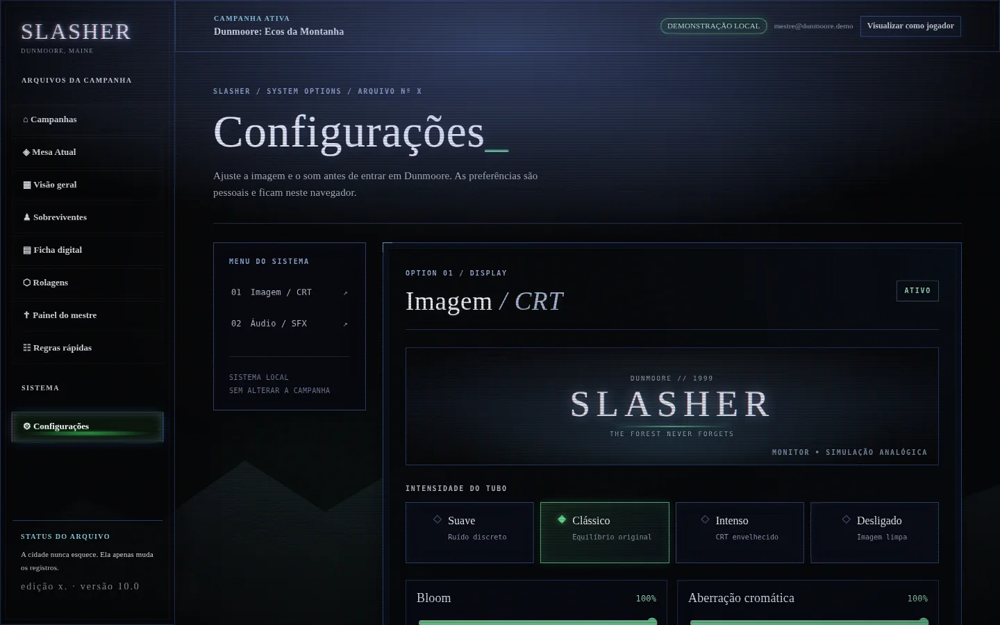
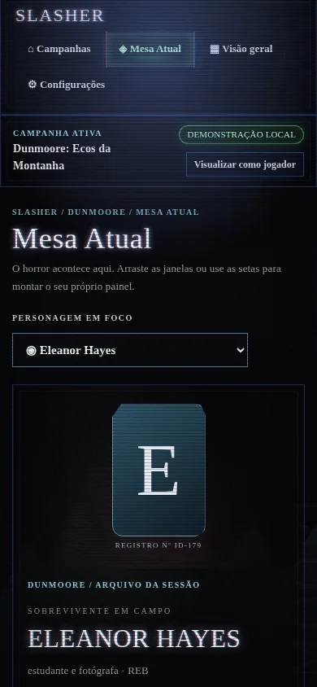

<div align="center">

# S L A S H E R

### DUNMOORE, MAINE · ARQUIVO Nº X

**A cidade nunca esquece. Só muda os registros.**

RPG digital de **survival horror, investigação e mistério**. Menus inspirados nos clássicos do PS1, efeitos CRT e uma mesa conectada diretamente entre jogadores e mestre.


**[🎮 Abrir SLASHER](https://ssunkem.github.io/slasher/) · [⌁ Conectar uma mesa](#-jogar-p2p) · [📺 Interface](#-interface) · [📁 Backup](#-arquivos-e-backups) · [📖 Manual](manual-6.html)**

</div>

---

## ⌁ O que mudou?

O **SLASHER 10.1 (P2P experimental)** funciona por padrão **sem Supabase**. O site é estático no GitHub Pages, mas as fichas, rolagens e alterações da sessão são sincronizadas via **WebRTC DataChannels**. O navegador do **mestre** é o host e mantém os dados oficiais da campanha.

- **Mestre:** cria ou abre uma campanha local, oferece conexões e mantém sua aba aberta.
- **Jogadores:** abrem o mesmo endereço, escolhem "Entrar na mesa do mestre" e participam sem criar contas.
- **RNG autoritativo do host:** o jogador solicita uma rolagem ou ataque; o mestre sorteia os valores e devolve o resultado confirmado. Isso impede que o jogador escolha livremente o resultado enviado ao host.
- **Permissões:** o host confere o dono da ficha, impede acesso a ações exclusivas do mestre e não compartilha as notas secretas do GM. Criaturas preparadas não são enviadas enquanto não há confronto ativo.
- **Persistência:** a campanha fica no navegador do host, com opção de exportar/importar um arquivo JSON de backup.

> [!IMPORTANT]
> **É um beta P2P com diagnóstico de conexão.** A conexão foi testada com um transporte WebRTC simulado e com a interface mestre/jogador no navegador. Ainda falta validar ICE/NAT com duas redes reais. Alguns roteadores ou operadoras precisam de retransmissão TURN, que não está configurada nesta versão. O modo P2P não garante conexão em qualquer rede.


> **10.1.2: Conexões manuais não usam TTL de convite.** O navegador tenta ICE enquanto o código de resposta ainda está sendo copiado. Antes de o mestre colar a resposta, `checking` ou até um `failed` precoce **não prova que o convite expirou**. O SLASHER agora mostra *Aguardando o mestre* durante essa etapa e ignora erros de convites antigos. O aviso de **45 segundos começa somente depois que o mestre aplica a resposta**. Se der falha após completar a troca, crie dois códigos novos.

## 🔪 Jogar P2P

Não há SQL, conta, token, `config.js` ou instalação de Supabase.

### No computador do mestre

1. Abra **[ssunkem.github.io/slasher](https://ssunkem.github.io/slasher/)** e escolha **Hospedar como mestre**.
2. Abra uma campanha existente ou clique em **Criar campanha**. Os arquivos ficam salvos neste dispositivo.
3. Na barra lateral, entre em **Sala P2P → Gerar convite para jogador**.
4. Copie o código longo do convite e envie **somente à pessoa que quer convidar**.
5. Quando o jogador enviar a resposta, cole-a em **Resposta** e clique em **Concluir conexão**.
6. Para adicionar outra pessoa, gere um novo convite. Não feche a aba do mestre durante a sessão.

### No navegador do jogador

1. Abra o **mesmo endereço** e escolha **Entrar na mesa do mestre**.
2. Informe seu apelido, cole o código recebido do mestre e clique em **Gerar resposta de conexão**.
3. Envie a resposta ao mestre. Assim que ele concluir a conexão, a **Mesa Atual** abre automaticamente.
4. Crie seu sobrevivente. O mestre pode acompanhar sua ficha, controlar monstros, itens e loja.

> A troca manual de dois códigos é a **sinalização** do WebRTC. Um código simples de sala ou convite em um clique exigiria um serviço de sinalização (mesmo que pequeno). Servidores **STUN públicos** são utilizados apenas para descobrir rotas de conexão; os dados da sessão não são enviados ao Supabase. Em redes que não permitem conexão direta, seria necessário um serviço **TURN**.

## 🧰 Conexão não abriu?

O **SLASHER 10.1.2** mostra as rotas ICE encontradas, o estado da negociação e falhas de conexão. Se o código de convite não tiver nenhuma rota WebRTC, ele avisa imediatamente em vez de deixar o jogador aguardando para sempre.

1. Teste primeiro com **PC e celular no mesmo Wi-Fi**, sem rede de convidados nem isolamento de dispositivos.
2. Desligue temporariamente VPN, bloqueios de WebRTC e conexões de dados móveis no celular.
3. Faça a troca **completa**: convite do mestre → resposta do jogador → mestre clica em **Concluir conexão**.
4. Mantenha ambas as abas abertas; não recarregue após gerar os códigos.
5. Se aparecer **0 rotas** ou ICE **failed**, tente outro navegador ou rede. Algumas combinações de NAT/CGNAT precisam de um servidor TURN e não podem ser resolvidas apenas com código no GitHub Pages.

O diagnóstico não transmite senhas nem credenciais e não envia sua campanha a um backend.

## 📺 Interface

> *Uma tela velha. Um arquivo aberto. Uma cidade que não deveria existir nos registros.*

<div align="center">
  
  <sub>Entrada P2P · A estética de Dunmoore, agora sem Supabase</sub>
</div>

<div align="center">
  
  <sub>Mesa Atual · CRT Clássico · Bloom 100% · Aberração cromática 100%</sub>
</div>

<br>

<div align="center">
  
  <sub>Configurações · Imagem, efeitos e áudio em uma única aba</sub>
</div>

<details>
<summary><b>📱 Ver a interface no celular</b></summary><br>
<div align="center"></div>
</details>

*As capturas mostram a identidade visual consolidada na versão 10.0; a edição P2P substituiu a antiga entrada por uma tela de hospedagem/conexão. A estética CRT permanece.*

### Funcionalidades atuais

| Para jogadores | Para o mestre | Atmosfera |
| :-- | :-- | :-- |
| 12 classes, retratos e atributos | Criar campanhas e NPCs | CRT Suave / Clássico / Intenso / Desligado |
| HP, Stamina e Estresse | Gerenciar fichas e condições | Bloom e aberração cromática reguláveis |
| Inventário e compra de itens | Loja, estoque, armas e catálogo | Efeitos sonoros lo-fi sintetizados |
| Testes D20 e combate | Monstros, HP, turnos e rolagens | Interface responsiva, vinheta e scanlines |
| Registros compartilhados | Arquivo da sessão armazenado localmente | Aba Configurações independente |

## 📁 Arquivos e backups

O **host salva os dados no armazenamento local do navegador**. Isso não equivale a um banco remoto nem é garantia de persistência: dados podem se perder se o usuário limpar o site, trocar de navegador ou entrar no modo privado.

Na tela **Campanhas**, o mestre encontra **Exportar backup** e **Restaurar backup**. O arquivo JSON guarda campanhas, fichas, rolagens, notas e dados da Mesa Atual. **Exporte ao final de cada sessão** e guarde uma cópia fora do navegador. A restauração substitui os arquivos locais e só é permitida quando não há jogadores conectados.

Os jogadores não mantêm uma cópia oficial da campanha. Se o mestre encerrar a aba, a sessão fica indisponível. **Reconexão automática e recuperação de identidade ainda estão em desenvolvimento**; se alguém retornar com uma nova conexão, o mestre talvez precise reatribuir a ficha.

## 🌐 Hospedagem

O aplicativo é estático. Para montar seu próprio endereço no GitHub Pages:

```bash
git clone https://github.com/ssunkem/slasher.git
cd slasher
python -m http.server 8000
```

O comando acima serve apenas para desenvolvimento local. No GitHub Pages, não é necessário operar um servidor de aplicação; o navegador do mestre é o host da sessão. O uso normal exige navegadores com WebRTC, uma conexão HTTPS (como GitHub Pages) e conectividade P2P entre os participantes.

**Limites atuais:** convite por troca manual de códigos, dependência de STUN público para conexão na internet, ausência de TURN, host sempre presente, sem autenticação persistente de identidade e sem testes de carga entre muitas pessoas. Compartilhe convites apenas com participantes de confiança. Conexões WebRTC podem expor endereços de rede entre os participantes.

## 🎛️ Configurações

A tela **Configurações** reúne intensidade CRT, bloom, aberração cromática, mute, volume e teste de sons. As preferências são individuais, permanecem no navegador e não precisam ser sincronizadas com a mesa.

## 🧪 Testes

Execute na raiz do projeto:

```bash
for file in tests/*.cjs; do node "$file"; done
```

Há testes da geração de dados, catálogo, formulários, controles CRT/SFX e fluxo de **oferta, resposta, sincronização e mensagens P2P** com transporte simulado. Testes reais de conectividade entre operadoras ainda são necessários antes de recomendar o P2P como solução universal.

## 📚 Arquivos principais

| Arquivo | Função |
| :-- | :-- |
| `index.html` | Entrada do aplicativo no GitHub Pages |
| `p2p.js` | Transporte WebRTC e sinalização por código |
| `app.js`, `mesa71.js` | Regras e interface de mesa |
| `crt.js`, `crt.css` | Monitor CRT e efeitos |
| `sfx.js`, `sfx.css` | Sons sintetizados |
| `settings-page.js`, `settings.css` | Aba Configurações |
| `SLASHER_P2P_Preview_Local.html` | Demo P2P em HTML único, sem arquivos externos |
| `SLASHER_Demo_Offline.html` | Demonstração individual anterior |
| `install.sql`, `schema.sql` | Arquivos históricos opcionais da integração Supabase; **não necessários para o P2P** |

---

<div align="center">

### S L A S H E R

*Três batidas. Uma voz conhecida do outro lado.*

**Não responda.**

`DUNMOORE / MAINE / ARQUIVO Nº X`

</div>