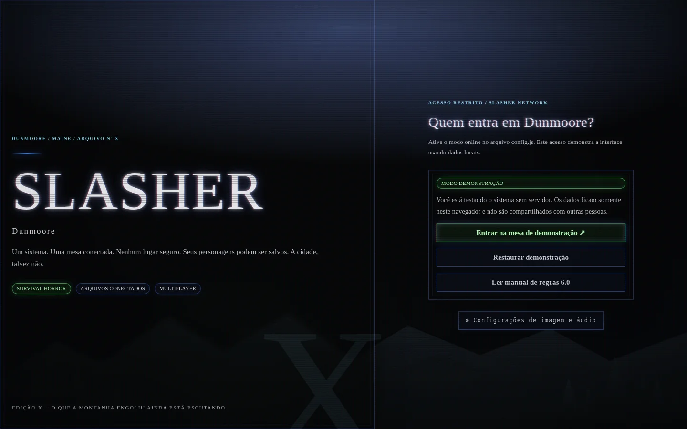

<div align="center">

# S L A S H E R

### DUNMOORE, MAINE · ARQUIVO Nº X

**A cidade nunca esquece. Só muda os registros.**

Um RPG de **survival horror, investigação e mistério**, com fichas digitais, mesa multiplayer e uma interface inspirada nos menus de jogos de terror do começo dos anos 2000.

[](https://github.com/ssunkem/slasher)


**[🎮 Abrir SLASHER](https://ssunkem.github.io/slasher/) · [📦 Instalar do zero](#-instalação-do-zero) · [📺 Ver telas](#-a-interface) · [📖 Manual](manual-6.html)**

</div>

---

## 📺 A interface

> *Uma tela velha. Um arquivo aberto. Uma cidade que não deveria existir nos registros.*

<div align="center">
  
  <sub>Mesa Atual — CRT Clássico · Bloom 100% · Aberração cromática 100%</sub>
</div>

<br>

<div align="center">
  
  <sub>Configurações — imagem e áudio reunidos numa única tela</sub>
</div>

<br>

<details>
<summary><b>📱 Ver versão mobile</b></summary>
<br>
<div align="center"></div>
</details>

<details>
<summary><b>🌘 Ver tela de entrada</b></summary>
<br>
<div align="center"></div>
</details>

**As capturas acima são reais**, feitas com a demonstração local do SLASHER 10.0. O modo utilizado foi **Clássico**, com **bloom e aberração cromática em 100%**, conforme o conceito visual do lançamento. No uso diário, você pode reduzir ou desligar os efeitos.

## 🔪 O que existe nesta edição

| Sobreviventes | Mestre | Atmosfera |
| :-- | :-- | :-- |
| 12 classes, atributos e retratos | Campanhas e convites por código | CRT configurável: suave, clássico, intenso e desligado |
| HP, Stamina, Estresse e condições | Painel de controle de personagens e NPCs | Bloom e aberração cromática independentes |
| Dados D20 com resposta imediata | Catálogo de monstros, armas e itens | Efeitos sonoros lo-fi sintetizados no navegador |
| Inventário, armas equipadas e dinheiro | Loja com estoque, preços e compras | Configurações reunidas numa aba própria |
| Combate com seleção de alvo e histórico | Monstros persistentes e rodadas de confronto | Interface responsiva com elementos de survival horror |

A **Mesa Atual** reúne inventário, rolagens, combate, loja, histórico, anotações e ferramentas de mestre em painéis que podem ser reorganizados. A identidade visual mistura menus clássicos de survival horror, tons escuros, brilho verde/azulado, scanlines, vinheta e névoa de Dunmoore.

**Dados locais:** o D20 e o dado de dano são sorteados pelo navegador com `crypto.getRandomValues`. O resultado aparece sem esperar a rede. O Supabase recebe a rolagem e, no combate, valida permissões, arma, defesa e alteração de HP antes de confirmar a ação.

> [!IMPORTANT]
> Como o sorteio acontece no cliente, alguém que modifique o navegador pode adulterar o resultado. O servidor **não garante a imparcialidade do dado local**. O projeto é voltado a mesas privadas de confiança, não a partidas competitivas. Falhas de sincronização devem ser verificadas no histórico antes de seguir o combate.

## 📦 Instalação do zero

Este guia parte de **um projeto novo e vazio do Supabase**. **Você só precisa de um arquivo SQL: [`install.sql`](install.sql).** Não é preciso seguir o histórico de atualizações nem executar scripts separados.

### 1. Criar o projeto no Supabase

1. Crie sua conta em [supabase.com](https://supabase.com/) e um **novo projeto**.
2. No painel de autenticação, habilite **Anonymous Sign-Ins** se quiser permitir o acesso rápido por nome de usuário. A opção de e-mail/senha também pode ser configurada conforme suas preferências.
3. Abra **SQL Editor → New query**.
4. Copie o arquivo **[`install.sql`](install.sql)** inteiro, cole no editor e execute **Run**. Esse script prepara tabelas, índices, políticas RLS, funções e eventos em tempo real necessários à versão 10.0.

> O instalador é para **banco novo**. Não o execute sobre campanhas antigas. Para manutenção de instalações existentes, use um procedimento de atualização específico após realizar backup.

### 2. Configurar a conexão

Abra [`config.js`](config.js) e preencha as duas informações públicas do seu projeto em **Project Settings / API** (a nomenclatura pode variar no painel do Supabase):

```js
window.SLASHER_CONFIG = {
  supabaseUrl: 'https://SEU-PROJETO.supabase.co',
  supabaseAnonKey: 'SUA_CHAVE_PUBLICA_ANON_OU_PUBLISHABLE'
};
```

Use apenas a **chave pública** (`anon`/`publishable`). **Nunca** coloque a `service_role`/`secret` no frontend, em commits ou em páginas públicas. As políticas RLS e a validação das funções do banco são responsáveis pelo controle de acesso.

### 3. Publicar o site

1. Faça um fork ou clone deste repositório.
2. Coloque seu `config.js` com a URL e a chave pública do seu projeto.
3. Publique a pasta como site estático no **GitHub Pages** ou em qualquer hospedagem HTTPS compatível. Não há etapa de build.
4. Abra o site e teste: entrar, criar campanha, entrar com convite, gerar uma ficha, rolar o D20 e iniciar um combate com dois navegadores diferentes.

```bash
git clone https://github.com/ssunkem/slasher.git
cd slasher
python -m http.server 8000
```

O servidor local acima é útil para desenvolvimento. A URL do site é `http://localhost:8000`. O modo conectado precisa de um projeto Supabase configurado; caso contrário, o SLASHER abre a demonstração local.

### 4. Testar sem Supabase

Abra **[`SLASHER_Demo_Offline.html`](SLASHER_Demo_Offline.html)** no navegador. A demonstração inclui sobreviventes, monstros, inventário e uma loja de exemplo. Ela **não conecta nem altera seu banco**. Algumas funcionalidades online, como sincronização entre jogadores, não são reproduzidas no modo offline.

## 🎛️ Configurações

Tudo fica em **Configurações**, acessível antes de entrar numa mesa ou pela navegação lateral:

- **Imagem:** modos CRT **Suave**, **Clássico**, **Intenso** e **Desligado**, além de sliders de bloom e aberração cromática entre 0% e 100%.
- **Áudio:** sons sintéticos de navegação, confirmação, voltar, equipar, comprar, dados e alertas, com volume, mute e botão para testar.
- As preferências são pessoais, salvas no navegador. Áudio não toca automaticamente. Animações respeitam `prefers-reduced-motion`.

## 🧭 Estrutura do projeto

```text
slasher/
├── index.html                  # Interface web
├── app.js                      # Campanhas, personagens, navegação
├── mesa71.js                   # Mesa, criaturas, loja, combate
├── styles.css / mesa71.css     # Layout e painéis
├── dunmoore.css                # Identidade visual
├── crt.css / crt.js            # Efeitos de TV CRT, bloom e RGB
├── sfx.css / sfx.js            # Efeitos sonoros lo-fi
├── settings.css / settings-page.js
├── dice-local.js              # Sorteio local com Web Crypto
├── config.js                  # Conexão pública Supabase
├── install.sql                # Banco completo, primeira instalação
├── SLASHER_Demo_Offline.html  # Demonstração independente
├── manual-6.html              # Manual do núcleo de regras
├── assets/                    # Capturas e recursos visuais
└── tests/                     # Testes automatizados com Node.js
```

### Testes locais

Os testes incluídos cobrem partes do inventário, formulários, catálogo, sorteios, CRT, sons e Configurações. Execute, por exemplo:

```bash
node tests/configuracoes.cjs
node tests/dados-locais.cjs
node tests/audio-ui.cjs
node tests/catalogo-dunmoore.cjs
```

## ⚠️ Estado do projeto

**SLASHER 10.0 ainda é um projeto experimental para mesas privadas.** O fluxo multiplayer depende de Supabase, das suas configurações de autenticação e das políticas do banco. Não há promessa de alta disponibilidade, recuperação automática de contas anônimas, antitrapaça para dados locais, rollback completo de ações ou testes de carga em produção. A interface offline não substitui a validação com contas reais.

A autenticação anônima pode perder o acesso às fichas se a sessão do navegador for apagada ou se o usuário sair sem vincular outra forma de login. Evite armazenar dados pessoais sensíveis nas notas de campanha. Teste suas permissões antes de usar em mesas abertas.

## 📓 Próximos arquivos a abrir

- [`CATALOGO_DUNMOORE.md`](CATALOGO_DUNMOORE.md): biblioteca inicial de criaturas, armas e ferramentas.
- [`manual-6.html`](manual-6.html): regras principais de investigação e sobrevivência, ainda compatíveis com a edição X.
- [Issues](https://github.com/ssunkem/slasher/issues): bugs, sugestões de mecânicas e feedback.

---

<div align="center">

### S L A S H E R

**DUNMOORE, MAINE · EDIÇÃO X · VERSÃO 10.0**

*O que a montanha engoliu ainda está escutando.*

</div>